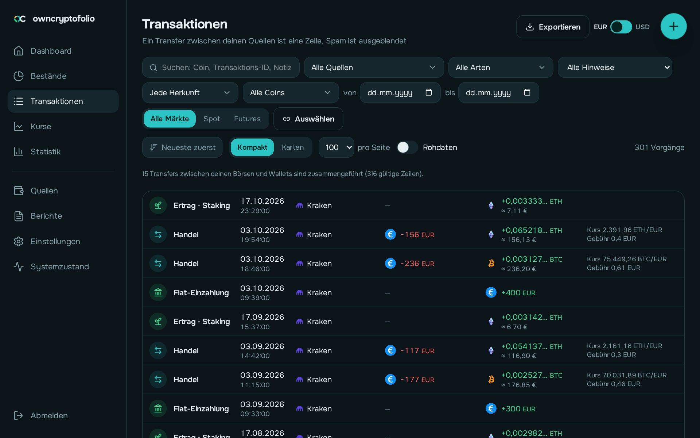
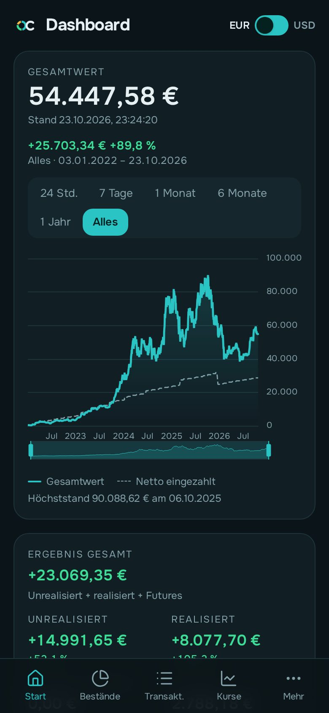

# owncryptofolio

[English](#owncryptofolio) · [Deutsch](#deutsch)

**A self-hosted crypto portfolio tracker with German tax reports.** It reads your exchanges,
wallets and files, merges them into one clean history, values everything with stored prices and
shows holdings, profit and loss — and, for Germany, the yearly tax report (§ 23, § 22, § 20 EStG)
and a source-of-funds statement for banks. Everything runs at home in one Docker container; your
data never leaves your server.

> **Built with [Claude Code](https://claude.com/claude-code).** This project was designed and
> written by its maintainer together with Anthropic's Claude Code — architecture, code, tests
> and documentation alike.

## Screenshots

<p>
  
  
</p>
<p>
  
  
</p>
<p>
  
  
</p>

All pages on PC and phone: [gallery](wiki/en/gallery.md). Every picture comes from a demo
database with invented data.

## What it does

- **Sources:** exchanges by API or export file (Bitget, Coinbase, Kraken, KuCoin, MEXC tested,
  56 more through ccxt in beta), 35 blockchain networks (Bitcoin, Ethereum and EVM networks,
  Solana, Cardano, XRP, Tron, TON, Polkadot, Cosmos, NEAR, …), your own CSV/Excel, manual entries.
- **One history:** transfers between your own wallets become one line, spam is hidden, nothing
  is ever overwritten (raw data first), every change has a history.
- **Portfolio:** holdings per coin and place, cost basis, realised and unrealised profit,
  statistics, balance check against what each exchange or network reports.
- **German tax:** FIFO or LIFO per wallet (as the BMF letter describes), holding period,
  exemption limits, loss carry-forward, Excel and PDF — plus a source-of-funds report.
- **Comfort:** mobile-first web app, nine styles, English and German interface, encrypted
  automatic backups with restore, a read-only JSON API and a Claude (MCP) connection.

Features marked **beta** are built from documentation and checked against public data, but
not yet against a real account of their own.

## Quick start

```yaml
# docker-compose.yml
services:
  db:
    image: postgres:17
    environment: { POSTGRES_PASSWORD: change-me }
    volumes: ["./postgres:/var/lib/postgresql/data"]
  owncryptofolio:
    image: ghcr.io/vanixxx/owncryptofolio:latest
    ports: ["8085:8080"]
    environment: { DB_HOST: db, DB_USER: postgres, DB_PASSWORD: change-me }
    volumes: ["./data:/data", "./backups:/backups"]
    depends_on: [db]
```

`docker compose up -d`, open `http://<host>:8085` and follow the setup. Details, `docker run`
without Compose and every variable: [wiki](wiki/en/guides/install-docker.md). On **Unraid**
there is a template: [install on Unraid](wiki/en/guides/install-unraid.md).

The image (`ghcr.io/vanixxx/owncryptofolio`) runs on amd64 and arm64 (64-bit Raspberry Pi).

Keep it inside your home network; for access on the road use a VPN.

## Documentation

- [User wiki](wiki/en/README.md) — installation, first start, every page of the app, concepts
  ([Deutsch](wiki/README.md))
- [Building an integration](wiki/en/guides/build-an-integration.md) — a new exchange or network
  is one folder; complete example and checklist
- [Developer notes](src/README.md) — stack, local development, tests
- [Changelog](CHANGELOG.md)

## Questions, bugs, ideas

[Issues](https://github.com/Vanixxx/owncryptofolio/issues) are welcome, in English or German,
and so are pull requests. owncryptofolio is a hobby project maintained in spare time, so an
answer may take a while. Security problems please privately: [SECURITY.md](SECURITY.md).

## Disclaimer

owncryptofolio helps you prepare your tax return; it is **not tax advice**. Check the results
and ask a tax adviser where rules are unclear.

## License

Copyright (C) 2026 Vanixxx

[GNU Affero General Public License v3.0](LICENSE) (AGPL-3.0): use, change and share it freely; whoever
distributes it — or offers a changed version as a web service — must publish their source code
under the same licence. Third-party works and their licences:
[THIRD-PARTY-NOTICES.md](THIRD-PARTY-NOTICES.md).

---

## Deutsch

**Ein selbst gehosteter Krypto-Portfolio-Tracker mit deutschem Steuerbericht.** owncryptofolio
liest deine Börsen, Wallets und Dateien, führt alles zu einer sauberen Historie zusammen,
bewertet mit gespeicherten Kursen und zeigt Bestände, Gewinn und Verlust — dazu den jährlichen
Steuerbericht (§ 23, § 22, § 20 EStG) und einen Herkunftsnachweis für Banken. Alles läuft zu
Hause in einem Docker-Container; deine Daten verlassen deinen Server nicht.

> **Entstanden mit [Claude Code](https://claude.com/claude-code).** Das Projekt wurde vom
> Betreuer gemeinsam mit Claude Code von Anthropic entworfen und geschrieben — Aufbau, Code,
> Tests und Dokumentation.

### Bilder

<p>
  
  
</p>

Alle Seiten auf PC und Handy: [wiki/bilder.md](wiki/bilder.md). Alle Bilder stammen aus einer
Beispiel-Datenbank mit erfundenen Daten.

### Was es kann

- **Quellen:** Börsen per API oder Exportdatei (Bitget, Coinbase, Kraken, KuCoin, MEXC getestet,
  56 weitere über ccxt als Beta), 35 Blockchain-Netzwerke (Bitcoin, Ethereum und EVM-Netzwerke,
  Solana, Cardano, XRP, Tron, TON, Polkadot, Cosmos, NEAR …), eigene CSV/Excel, Einträge von Hand.
- **Eine Historie:** Transfers zwischen deinen Wallets werden eine Zeile, Spam wird ausgeblendet,
  nichts wird überschrieben (Rohdaten bleiben), jede Änderung hat einen Verlauf.
- **Portfolio:** Bestände je Coin und Ort, Einstand, realisierter und unrealisierter Gewinn,
  Statistik, Abgleich mit dem, was Börse oder Netzwerk melden.
- **Steuer (Deutschland):** FIFO oder LIFO je Wallet (walletbezogen, wie im BMF-Schreiben),
  Haltefrist, Freigrenzen, Verlustvortrag, Excel und PDF — dazu der Herkunftsnachweis.
- **Komfort:** fürs Handy gebaut, neun Stile, Deutsch und Englisch, verschlüsselte automatische
  Sicherungen mit Wiederherstellung, eine JSON-API zum Lesen und eine Anbindung an Claude (MCP).

Was als **Beta** markiert ist, wurde nach der Dokumentation gebaut und an öffentlichen Daten
geprüft, aber noch nicht an einem eigenen Konto.

### Schnellstart

Die `docker-compose.yml` oben übernehmen, `docker compose up -d`, dann `http://<rechner>:8085`
öffnen und der Einrichtung folgen. Ausführlich — auch ohne Compose und mit allen Variablen — im
[Wiki](wiki/anleitungen/installation-docker.md); für **Unraid** gibt es eine Vorlage:
[Installation auf Unraid](wiki/anleitungen/installation-unraid.md). Das Abbild
(`ghcr.io/vanixxx/owncryptofolio`) läuft auf amd64 und arm64. Nur im Heimnetz betreiben; von
unterwegs per VPN.

### Dokumentation

- [Benutzer-Wiki](wiki/README.md) — Installation, erster Start, jede Seite der App, Hintergründe
  ([English](wiki/en/README.md))
- [Eigene Integration bauen](wiki/anleitungen/eigene-integration.md) — eine neue Börse oder ein
  neues Netzwerk ist ein Ordner; mit Beispiel und Checkliste
- [Hinweise für Entwickler](src/README.md) · [Änderungen](CHANGELOG.md)

### Fragen, Fehler, Ideen

[Issues](https://github.com/Vanixxx/owncryptofolio/issues) sind willkommen, auf Deutsch oder
Englisch, Pull Requests ebenso. owncryptofolio ist ein Hobbyprojekt, eine Antwort kann dauern.
Sicherheitslücken bitte privat melden: [SECURITY.md](SECURITY.md).

### Hinweis

owncryptofolio hilft dir, die Steuererklärung vorzubereiten; es ist **keine Steuerberatung**.
Prüfe die Ergebnisse und frag eine Steuerberatung, wo Regeln unklar sind.

### Lizenz

Copyright (C) 2026 Vanixxx

[GNU Affero General Public License v3.0](LICENSE) (AGPL-3.0): frei nutzen, ändern und weitergeben;
wer es weitergibt — oder eine geänderte Fassung als Webdienst anbietet —, muss seinen Quellcode unter
derselben Lizenz offenlegen. Fremde Werke und ihre Lizenzen:
[THIRD-PARTY-NOTICES.md](THIRD-PARTY-NOTICES.md).
