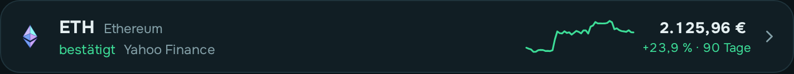
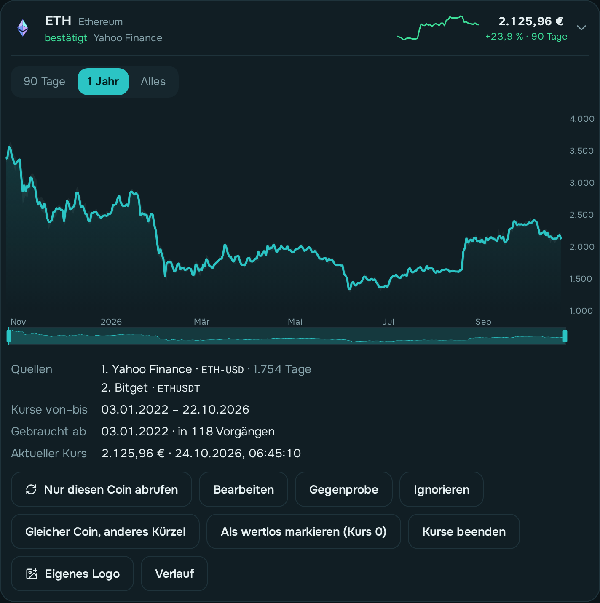

# Kurse

## In einem Satz

owncryptofolio holt jeden Morgen die Tageskurse aller deiner Coins. Du prüfst einmal je
Coin, ob die Zuordnung stimmt, und bestätigst sie.

## Warum du prüfen musst

Ein Kürzel ist nicht eindeutig. „BTC“ steht für elf verschiedene Münzen. Eine falsche
Zuordnung liefert nicht *keinen* Kurs, sondern einen **falschen**, und der würde
unbemerkt in Gewinn und Verlust wandern. Deshalb macht owncryptofolio nur einen
**Vorschlag**, und du bestätigst ihn.

## So prüfst du einen Coin

  
  

1. Seite **Kurse** → Auswahl **Zu prüfen**.
2. Coin antippen. Du siehst:
   - die **Kurve**. Passt sie zu dem, was du von dem Coin kennst?
   - die **Quellen** in Rangfolge und wie viele Tage jede geliefert hat;
   - den **aktuellen Kurs**.
3. **Gegenprobe** vergleicht zwei Quellen (Yahoo und Bitget) über 90 Tage. Unter 2 %
   Abweichung ist unauffällig. Bei mehr steckt oft eine andere Münze dahinter.
4. Passt alles: **Bestätigen**.

## Wenn etwas nicht stimmt

- **Bearbeiten**: Klarname und Quellen ändern. Ändert sich eine Quelle, brauchst du
  einen **Grund**. Das Finanzamt verlangt eine dokumentierte, gleichmäßige Bewertung.
  Unter **Verlauf** steht jede Änderung mit Grund.
- Bei **Yahoo** haben manche Coins eine Nummer im Kürzel, z. B. The Graph
  `GRT6719-USD`. Auf finance.yahoo.com nach dem Namen suchen.
- **CoinGecko** braucht die Kennung aus der Adresszeile (z. B. `vara-network`) und
  reicht nur etwa ein Jahr zurück.
- **Ignorieren**: für Spam-Token, die dir jemand geschickt hat. Sie bekommen keinen Kurs
  und zählen nirgends mit. Du findest sie unter der Auswahl **Ignoriert**; **Nicht mehr
  ignorieren** holt einen Coin zurück.
- Die Auswahl **Ohne Kurs** zeigt alle Coins, für die noch keine Quelle einen Tageskurs
  geliefert hat.

## Gleicher Coin, anderes Kürzel

Manche Börsen nennen denselben Coin anders, z. B. MEXC „NTGL“ und Bitget „NGL“ (Entangle).
Coin aufklappen → **Gleicher Coin, anderes Kürzel** → das Kürzel eintragen, unter dem er
geführt wird, dazu Klarname und Grund. Deine eingelesenen Zeilen bleiben unverändert; für
Kurse und später für Bestände zählt beides als ein Coin. Unter **Auch als** lässt sich das
wieder trennen.

## Wertlos ab einem Datum

Ist ein Projekt eingeschlafen, hat sein Coin oft keinen Kurs mehr. Coin aufklappen → **Als
wertlos markieren (Kurs 0)**, das Datum und einen Grund eintragen. Ab diesem Tag zählt der
Coin mit 0, und sein Verlust erscheint im Ergebnis. In der Liste steht dann *„wertlos ab
…“* statt einer Warnung. **Wertlos zurücknehmen** hebt es auf.

## Kurse beenden (Coin umgestellt)

Wurde ein Coin in einen anderen umgestellt (z. B. AGIX → FET 2024), liefern die Kursquellen
für den alten Coin oft nur noch Unsinn. Coin aufklappen → **Kurse beenden**, den letzten Tag
mit Kurs und einen Grund eintragen. Bis zu diesem Tag gelten die Kurse wie bisher, danach
holt die App keine mehr und entfernt spätere. Anders als bei „wertlos“ zählt der Coin danach
nicht mit 0. In der Liste steht *„bis …“*. **Kurse wieder abrufen** hebt es auf.

## Einen Coin einzeln abrufen

Nach einer Änderung an den Quellen eines Coins musst du nicht auf den nächsten Morgen
warten: Coin aufklappen → **Nur diesen Coin abrufen**. Darunter steht, wie viele Tageskurse
neu dazukamen.

## Symbol

Fehlt das Logo oder ist es falsch, unter **Bearbeiten → Symbol** das Kürzel eintragen, unter
dem das Icon-Paket den Coin führt (z. B. RNDR für RENDER). Die Vorschau zeigt es sofort.

## Live-Kurse

Solange die Seite Kurse offen ist, werden die aktuellen Kurse alle 30 Sekunden erneuert. Ein
Kurs, der sich bewegt hat, blinkt kurz grün oder rot. Über **Suche** und **Sortieren** (Nutzung,
Name, Kurs, Veränderung) findest du einen Coin schnell.

## Was „ohne Kurs“ heißt

Findet keine Quelle einen Kurs, bleibt der Coin **unbewertet**, nie mit 0. Eine 0 sähe
aus wie ein Totalverlust. Die Kurs-Seite zeigt, für welchen Zeitraum der Kurs fehlt. Ist der
Coin wirklich nichts mehr wert, markiere ihn als wertlos (siehe oben).

## Einstellungen

Unter **Einstellungen → Kursabruf**: täglicher Abruf (Standard 04:30, nach dem Abruf der
Quellen), wie oft der aktuelle Kurs im Hintergrund erneuert wird (Standard alle 5 Minuten)
und die **Standard-Rangfolge der Quellen** für neue Vorschläge. Standard ist **Yahoo**, dann
Bitget, dann Binance: So werden alle Coins möglichst aus derselben Quelle bewertet. Eine
andere Quelle steht nur dort vorn, wo Yahoo keinen brauchbaren Verlauf hat (z. B. RON, QUBIC).
Nach einer Umstellung macht **Unbestätigte neu vorschlagen** die noch offenen Coins neu.
**Kurse abrufen** oben auf der Seite startet einen Lauf sofort.

## Veränderung

Neben dem Kurs steht die Veränderung in Prozent. Den Zeitraum wählst du über der Liste:
**heute** (gegenüber dem letzten Tagesschluss), **24 Std.**, **7 Tage**, **30 Tage** oder
**90 Tage**. Die App merkt sich die Wahl. Für 24 Stunden nutzt sie die feinen Kurse, die sie
stündlich holt (alle 5 Minuten für 31 Tage, stündlich für 90 Tage).

Die **Kurve** neben dem Kurs zeigt denselben Zeitraum: heute und 24 Std. aus den
5-Minuten-Kursen, 7 und 30 Tage aus den Stundenkursen, 90 Tage aus den Tageskursen. Ihre
Farbe richtet sich nach der Veränderung daneben (grün = gestiegen, rot = gefallen).

