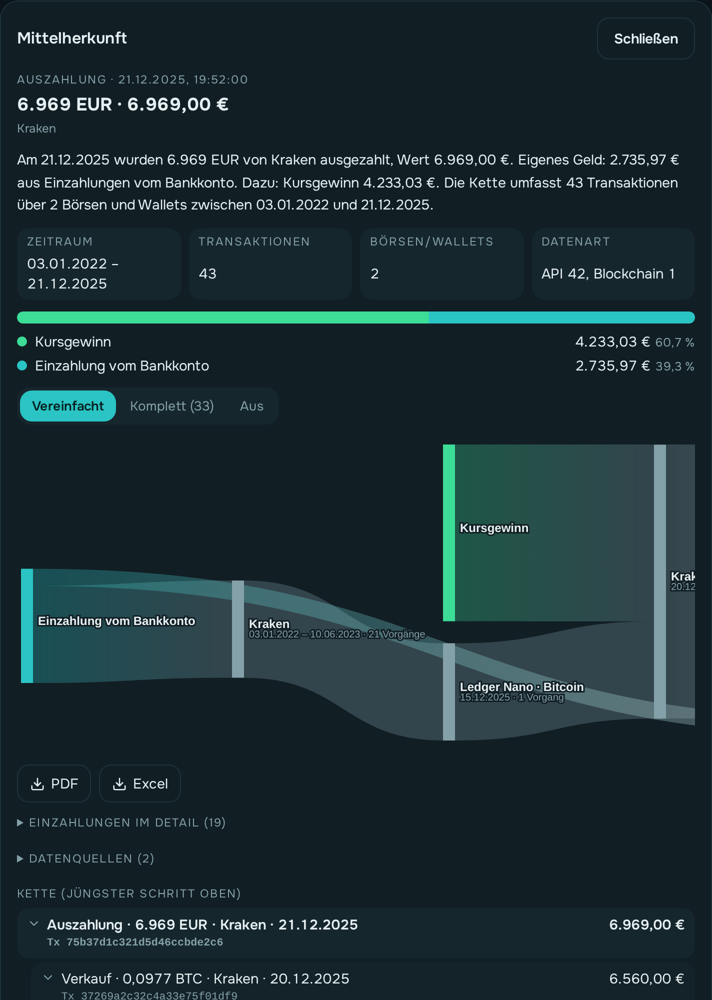

# Mittelherkunft nachweisen

Banken, Notare und manche Börsen wollen wissen, **woher das Geld stammt**, bevor sie eine
größere Summe annehmen. owncryptofolio verfolgt dafür jeden Vorgang zurück bis zu deinen
Einzahlungen und erstellt einen Nachweis als PDF.

**Beispiel:** [Nachweis für eine Auszahlung als PDF](../beispiele/mittelherkunft-auszahlung.pdf) —
aus den Beispieldaten (erfundener Name, erfundene Adressen).

## So gehst du vor

1. **Berichte** öffnen und oben **Mittelherkunft** wählen.
2. In der Liste stehen alle **Verkäufe**, **Transfers** (auch zwischen deinen eigenen
   Wallets), **Auszahlungen** und **Zahlungen** an Dritte, die neuesten oben. Mit der Auswahl
   oben grenzt du die Art ein, die Suche findet Coin, Ort oder Jahr.
3. Einen Vorgang anklicken. Oben erscheint ein kurzer Text in Worten und eine **Übersicht**
   (Zeitraum der Kette, Anzahl Transaktionen, beteiligte Börsen/Wallets, Datenart). Dazu:
   - die **Aufteilung**: wie viel des Betrags aus welcher Herkunft stammt (Balken und Liste);
   - die **Kette**: jeder Schritt zurück, der jüngste oben, mit Datum, Ort und
     Transaktions-ID. Zweige klappst du mit dem Pfeil auf und zu;
   - aufklappbar **Einzahlungen im Detail** (jede Überweisung oder Kartenzahlung mit Datum,
     Betrag, dem hier genutzten Anteil und ID — zum Abgleich mit dem Kontoauszug) und
     **Datenquellen** (Börsen und Wallets mit Adresse und Datenart);
   - das **Diagramm** des Geldflusses: **Vereinfacht** (je Börse/Wallet ein Kasten, links die
     Herkunft, rechts der Vorgang, rot die Kursverluste), **Komplett** (jeder Schritt) oder **Aus**.
     Mit der Maus darüber oder durch Antippen zeigt ein Kasten oder Strom seine Beträge und
     Verbindungen; ein Kasten lässt sich zur Seite ziehen. Große Diagramme scrollen; am Handy
     ist das vereinfachte meist ohne Scrollen ganz zu sehen;
   - **PDF** (am Ende das Diagramm vereinfacht und komplett, ein großes komplettes auf A3)
     und **Excel** zum Herunterladen.

  

## Herkunft des heutigen Bestands

Oben **Heutiger Bestand** wählen. Du siehst, woher dein gesamter Bestand stammt — jeder
Coin und die Euro auf den Börsen, bewertet zum aktuellen Kurs. Was über den Kosten liegt,
heißt **Kursgewinn (noch nicht verkauft)**; liegt der Wert darunter, schrumpfen die Anteile
im selben Verhältnis. Darunter die Coins mit einem kleinen Balken ihrer Herkunft; ein Klick
zeigt die Kette dieses Coins. PDF und Excel gibt es für den ganzen Bestand und für jeden
Coin.

## Geplante Transaktion

Du willst eine Auszahlung oder einen größeren Transfer erst noch machen und den Nachweis
vorher haben (z. B. weil die Bank oder Börse ihn verlangt)? Oben **Geplante Transaktion**
wählen, **Datum**, **Von** (Börse oder Wallet), **Coin** und **Menge** eintragen (**Alles**
übernimmt den ganzen Bestand dort) und **Nachweis erstellen**. Die App zeigt, welche
Bestände der Vorgang jetzt nach deiner Steuer-Einstellung nähme und woher ihr Geld stammt,
bewertet zum heutigen Kurs. **Gebucht wird nichts.** Ändert sich dein Bestand bis zur
Ausführung, kann sich die Herkunft ändern — das steht auch im PDF.

Aus einer einzelnen Transaktion kommst du auch direkt hin: Transaktion aufklappen → Reiter
**Steuer** → **Mittelherkunft anzeigen**.

## Was die Herkunftsarten bedeuten

| Herkunft | Bedeutung | Beleg, den du beilegst |
|---|---|---|
| **Einzahlung vom Bankkonto** | eigenes Geld per Überweisung an die Börse, oder ein Kauf direkt per SEPA bezahlt („Bezahlt direkt vom Bankkonto“) | Kontoauszug |
| **Kauf per Karte** | Coins direkt mit deiner Karte gekauft (auch „Bezahlt direkt per Karte“, z. B. MEXC) | Kartenabrechnung |
| **Kursgewinn** | Wertzuwachs zwischen Kauf und Verkauf (bzw. Transfer) | Transaktionsverlauf der Börse |
| **Ertrag** | Staking, Belohnungen, Airdrops | Auszug der Börse |
| **Futures-Ergebnis** | Gewinne aus dem Futures-Konto | Auszug der Börse |
| **Zufluss ohne erfassten Kauf** | Coins kamen herein, ein Kauf ist nicht erfasst | eigener Nachweis nötig |
| **Kursverlust** | Wertverlust zwischen Kauf und Verkauf, als **negativer** Anteil: die Herkunft zeigt das volle eingesetzte Geld, der Verlust zieht davon ab (Anteile über 100 % möglich) | – |
| **Euro ohne erfasste Einzahlung** | Euro wurden ausgegeben, die Einzahlung fehlt in den Daten | eigener Nachweis nötig |

Die beiden letzten Arten zeigen, **wo in deinen Daten noch etwas fehlt**. Meist hilft es,
die fehlende Quelle einzulesen oder den Vorgang zu markieren (siehe
[Transaktionen](transaktionen.md)).

## Gut zu wissen

- **Reihenfolge**: Welche Bestände ein Verkauf verbraucht, folgt deiner Steuer-Einstellung
  (FIFO oder LIFO). Steuerbericht und Herkunftsnachweis passen so zusammen.
- **Transfers** ändern die Herkunft nicht, sie stehen aber in der Kette — mit
  Transaktions-ID als Beleg. Ein Transfer zählt mit seinem Wert am Tag; was über den
  Kosten liegt, ist „Kursgewinn bis zum Transfer“.
- **Tausch** (z. B. USDT → LTC) steht als ein Schritt mit beiden Seiten in der Kette.
- **Umbuchungen Spot ↔ Futures** erscheinen als eigener Schritt. Manche Börsen buchen die
  Ankunft vor dem Abgang; die Kette führt trotzdem zu den echten Käufen.
- **Datenart**: API (von der Börse abgerufen), Blockchain, Datei (Export) oder von Hand.
  Von Hand erfasste Schritte brauchen eher einen eigenen Beleg.
- **Kleine Anteile**: Zweige unter 1 % des Betrags fasst der Nachweis zusammen und nennt
  ihre Herkunft. Die **Excel-Datei** enthält jeden einzelnen Schritt.
- **Verluste durch Pleite oder Betrug** sind nicht Teil der Kette; verlorene Bestände
  tragen zu keinem späteren Betrag bei. Der Nachweis weist darauf hin.
- **Name und Anschrift** im Kopf des PDFs trägst du unter **Einstellungen → Steuer** ein.
  Leer lassen geht auch. Die Steuernummer steht nur im Steuerbericht, nicht im Nachweis.
- Im **Excel** stehen Token-Namen und Notizen immer als Text, nie als Formel.

Der Nachweis wertet deine erfassten Daten aus. Er ist keine Rechts- oder Steuerberatung.

## Verwandte Seiten

- [Steuerbericht](steuerbericht.md)
- [Haltefrist und Steuer](../konzepte/haltefrist-und-steuer.md)
- [Transaktionen](transaktionen.md)
