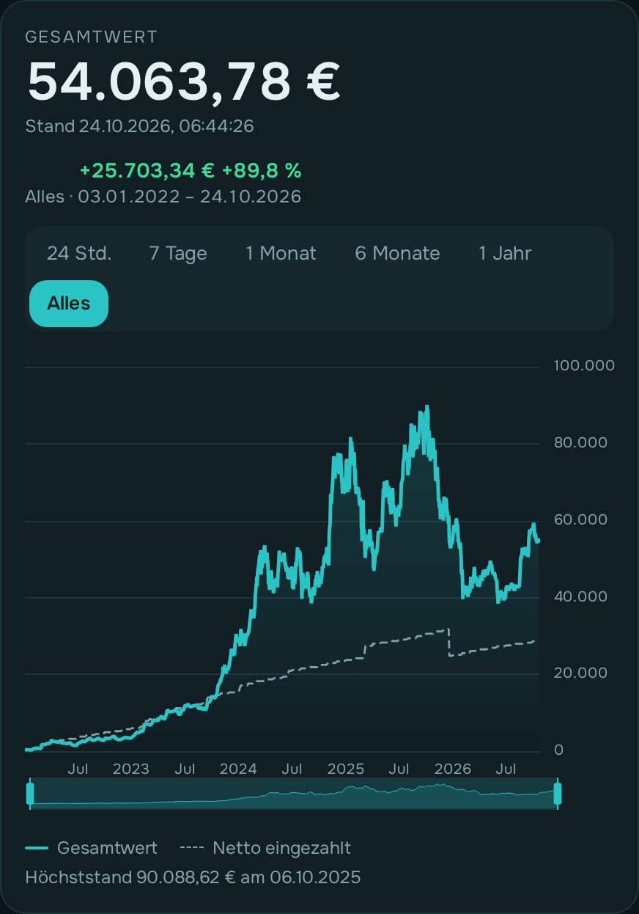
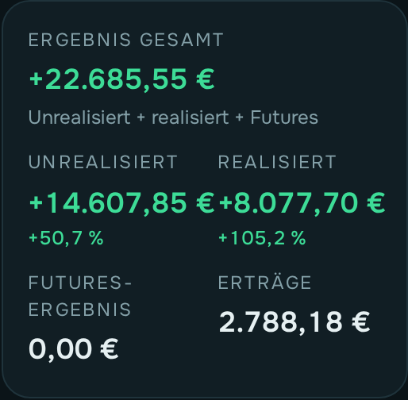
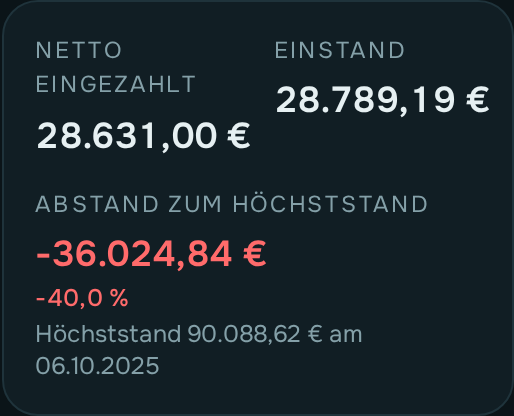
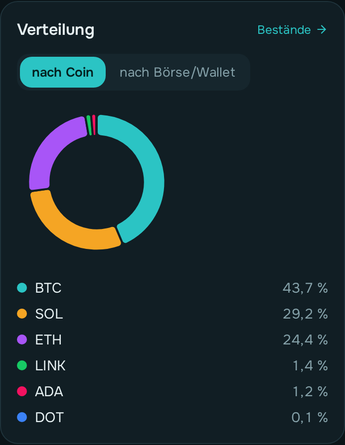
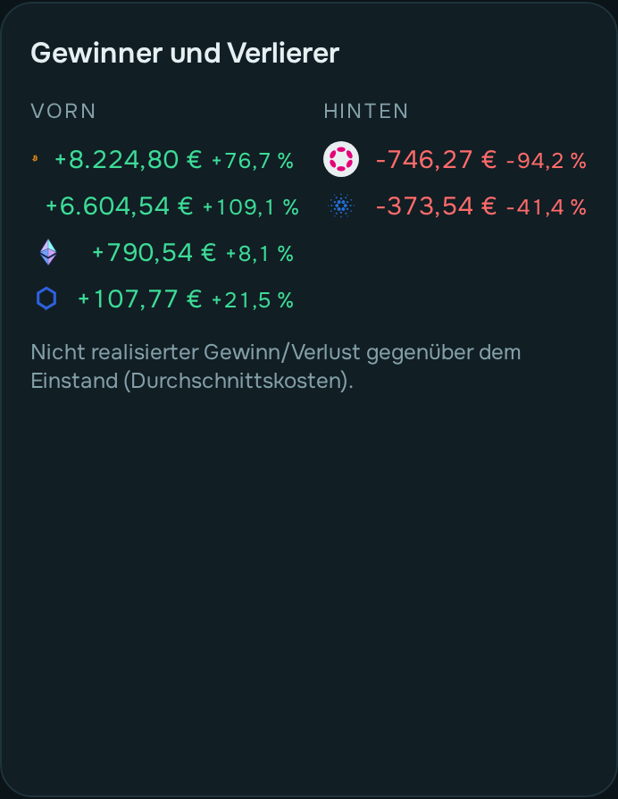
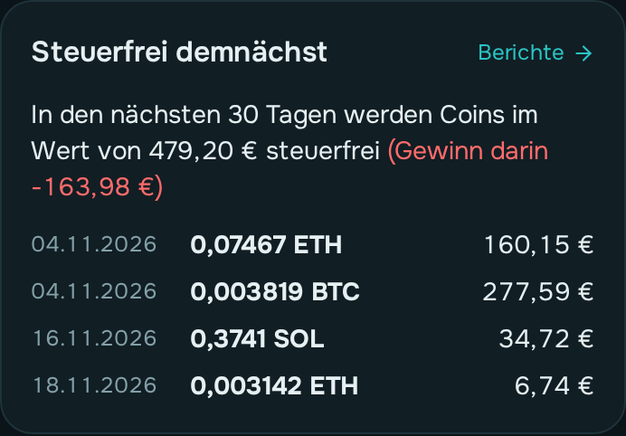
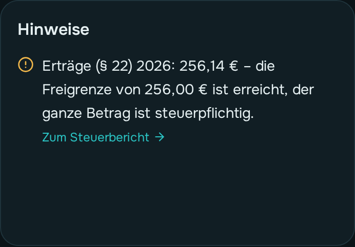
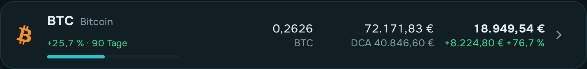
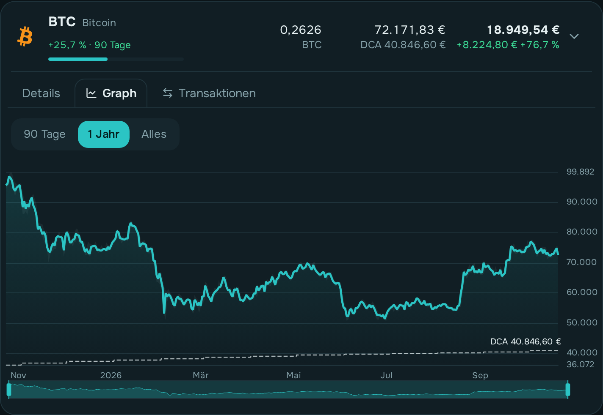
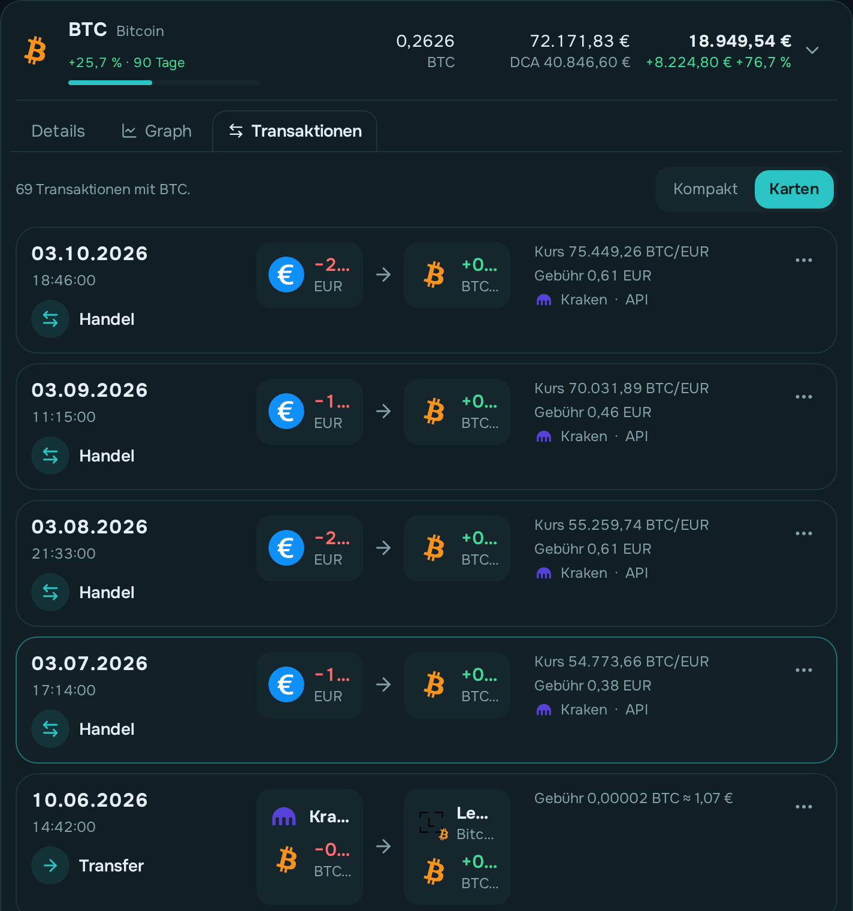

# Dashboard und Bestände

owncryptofolio rechnet aus deinen zusammengeführten Transaktionen und den Kursen aus, was
du besitzt, was es wert ist und was du gewonnen oder verloren hast. Gespeichert wird davon
nichts: Jede Korrektur an einem Vorgang wirkt sofort auf alle Zahlen.

## Dashboard

Die Startseite zeigt dein Portfolio auf einen Blick:

  

- **Gesamtwert**: alle Coins zum aktuellen Kurs plus Bargeld auf Börsen. Solange die Seite
  offen ist, erneuert er sich jede Minute. Daneben steht die Veränderung im gewählten
  Zeitraum.
- **Verlauf**: der Wert über die Zeit, wahlweise für 24 Stunden, 7 Tage, 1 Monat, 6 Monate,
  1 Jahr oder alles; mit dem Schieber darunter wählst du einen Ausschnitt. **24 Std., 7 Tage
  und 1 Monat** zeigen die feinen Werte (alle 5 Minuten für 31 Tage, danach stündlich bis
  90 Tage; die App rechnet sie stündlich aus feinen Kursen je Coin neu, auch für Zeiten, in denen sie
nicht lief). Geladen wird jeweils der
  nächstlängere Zeitraum zum Zurückscrollen: bei 24 Std. 3 Tage, bei 7 Tagen 1 Monat, bei
  1 Monat 3 Monate. Der Schieber steht auf dem gewählten Zeitraum. Bei den längeren Zeiträumen
  zeigt ein **blasses Band** Tageshoch und -tief, wo es feine Werte gibt. Unter dem Ergebnis steht der gewählte Zeitraum mit Datum. Ein Tipp auf **Netto eingezahlt**
  unter dem Graphen blendet die gestrichelte Linie aus oder wieder ein.
  Die gestrichelte Linie ist das, was du netto eingezahlt hast. Liegt der Wert darüber, bist
  du im Plus. Der **Höchststand** ist der höchste Tageswert, den dein Portfolio je hatte.

  
  

- **Ergebnis gesamt**: unrealisiert plus realisiert plus Futures. Dazu siehst du die
  Erträge, also Staking und Rewards zum Wert bei Zufluss.
- **Netto eingezahlt**: Euro-Einzahlungen minus Auszahlungen. Hast du per Karte gekauft
  (bei einer Börse ohne Guthaben, mit „Per Karte bezahlt“ oder bei Coinbase per Karte/PayPal),
  zählt der ganze Betrag als eingezahlt. Der Hinweis „davon per Karte“ nennt die Summe.
- **Abstand zum Höchststand**: wie weit der Wert jetzt unter dem besten Tag liegt.

  
  

- **Verteilung**: welcher Anteil am Wert auf welchen Coin entfällt, oder umgeschaltet auf
  welche **Börse/Wallet** (die Netzwerke einer Wallet zusammen).
- **Gewinner und Verlierer**: die fünf Coins mit dem höchsten und dem niedrigsten nicht
  realisierten Ergebnis.

  
  

- **Steuerfrei demnächst**: was in den nächsten 30 Tagen die Haltefrist erreicht, mit Wert
  und dem Gewinn, der dann steuerfrei wäre.
- **Hinweise**: was die Zahlen unsicher macht, z. B. ein fehlgeschlagener Abruf, jeweils
  mit dem Weg zur Behebung — und ab 80 % der Hinweis, dass die steuerliche Freigrenze des
  laufenden Jahres näher rückt (Verkäufe 1.000 €, Erträge 256 €).

## Bestände

  

Die Seite **Bestände** hat drei Reiter.

### Spot

Für jeden Coin siehst du Menge, Wert, Gewinn oder Verlust in Geld und Prozent sowie seinen
Anteil am Portfolio als Balken. Am PC stehen zusätzlich die Kurve des gewählten Zeitraums (heute, 24 Std., 7, 30 oder 90 Tage) mit
der Veränderung in %, Kurs
und DCA (Ø-Kaufpreis) in eigenen Spalten. Oben findest du einen Coin über die Suche. Ein Klick auf den Coin öffnet ihn mit
drei Reitern:

  

**Graph**: der Kurs über die Zeit und dein **Ø-Kaufpreis als gestrichelte Stufenlinie**. Jede
Stufe ist ein Kauf, der den Durchschnitt verändert hat. Liegt die Kurve über der Linie, bist
du mit diesem Coin im Plus.

  

**Transaktionen**: alle Transaktionen mit diesem Coin, neueste zuerst. **Kompakt** zeigt eine
Zeile je Transaktion (Art, Datum, Ort, wie viel vom Coin rein oder raus ging, Wert), ein
Antippen öffnet sie als Karte mit allen Details (nochmal antippen: wieder eine Zeile);
**Karten** zeigt sie wie auf der Seite Transaktionen (aufklappen, bearbeiten, Notiz). Am Handy
startet die kompakte Liste; deine Wahl wird gemerkt. Darunter führt ein Link zur Seite Transaktionen,
dort schon nach dem Coin gefiltert.

**Details**:

- **DCA (Ø Kaufpreis)**: ab diesem Kurs bist du im Plus (siehe
  [Kostenbasis](../konzepte/kostenbasis-gewinn-verlust.md)). Daneben **Kurs jetzt** und der
  **Einstand** des heutigen Bestands.
- **Realisiert**: der Gewinn oder Verlust aus Verkäufen dieses Coins.
- **Erträge (Marktwert bei Zufluss)**: Staking, Rewards usw. dieses Coins, wenn es welche gibt.
- **Im Besitz** (seit): wann der heutige Bestand zuletzt von null angefangen hat.
- **Haltefrist**: wie viel Prozent des Bestands schon steuerfrei sind und ab wann der nächste
  Teil steuerfrei wird.
- **Wo**: auf welcher Börse oder Wallet der Coin liegt, mit Logo. „Eigene Wallet, nicht
  erfasst“ heißt: Du hast einen Abgang so markiert.
- **Ungeklärt**: Es wurde mehr abgegeben, als laut den Daten vorhanden war. Dafür wird kein
  Gewinn gebucht, siehe Lücken.
- **Offen versendet**: so viel ging ohne Gegenstück hinaus und zählt nicht mehr zum Bestand.

Über **Sortieren nach** ordnest du die Liste nach Wert, Gewinn/Verlust (auch in Prozent),
Realisiert, Kursänderung im Zeitraum, Besitzdauer oder Name; der Pfeil daneben dreht die Reihenfolge um.

„Verkaufte zeigen“ blendet Coins ein, die du nicht mehr hast, mit ihrem realisierten
Ergebnis.

### Futures

Hier stehen das Futures-Ergebnis, das Funding und die Gebühren getrennt vom Spot-Ergebnis,
darunter nur die Positionen, die **noch offen** sind. Eine Position gilt als offen, wenn die
Börse noch Funding zahlt, aber keine Schlussabrechnung geliefert hat.

**Abgeschlossene Positionen** stehen unter **Transaktionen**, jede als eine Zeile mit
Kontrakt, Long oder Short, Ergebnis, Funding und Gebühren. Aufgeklappt siehst du die
einzelnen Buchungen. Wähle dort als Art „Position“, um nur sie zu sehen.

### Lücken

Hier siehst du, **wo Vorgänge fehlen**:

- **„fehlt ab …“**: Der aus deinen Vorgängen errechnete Bestand fällt an diesem Tag unter
  null. Vor diesem Tag fehlt ein Zugang (Kauf, Einzahlung, Ertrag). Der kleine Verlauf zeigt
  den Bestand über die Zeit, rot ist der fehlende Teil.
- **„Kontostand weicht ab“**: Der Bestand fällt nie unter null, passt aber nicht zum
  Kontostand der Quelle. Wann etwas fehlt, lässt sich dann nicht sagen.

Die Liste ist nach dem fehlenden Wert sortiert, das Wichtigste steht oben. **Vorgänge
ansehen** öffnet die Transaktionen mit passendem Filter (diese Quelle, dieser Coin, bis zu
dem Tag). Trag die fehlenden Vorgänge nach, per Datei oder von Hand, dann verschwindet die
Lücke.

## Was wie gerechnet wird

- **Durchschnittskosten je Coin über alle Quellen.** Ein Transfer zwischen deinen Börsen und
  Wallets nimmt seine Kosten mit, die Netzgebühr erhöht den Einstand.
- **Ein Handel ist ein Verkauf** zum Wert der Gegenseite, also Euro, wenn vorhanden, sonst
  dem Tageskurs.
- **Ein Abgang „an Fremde“** zählt wie ein Verkauf zum Tageskurs, ein Abgang **„verloren“**
  als Totalverlust. Ein **offener Abgang** ohne Markierung verlässt den Bestand ohne Gewinn.
  Markiere ihn, dann rechnet das Programm richtig, siehe
  [Transaktionen](transaktionen.md#was-ohne-gegenstück-bleibt-markieren).
- **Ein Eingang ohne Gegenstück** zählt als „von außen“ zum Tageswert, bis du ihn markierst:
  eigene Wallet, außerhalb gekauft oder Ertrag.
- **Eine Umstellung** (Token-Umtausch, z. B. 1:1000) ändert nur die Menge; Kaufpreis und
  Kaufdatum bleiben.
- **Euro und Dollar** sind Bargeld, ohne Gewinn oder Verlust.
- Gerechnet wird in Euro; die Anzeige in Dollar nutzt den Kurs der Europäischen Zentralbank.

## Verwandte Seiten

- [Kostenbasis, Gewinn und Verlust](../konzepte/kostenbasis-gewinn-verlust.md)
- [Transaktionen zusammenführen](../konzepte/transaktionen-zusammenfuehren.md)
- [Quellen einrichten](quellen.md), darin der Abschnitt zum Bestandsabgleich
- [Transaktionen](transaktionen.md): Lücken schließen, Vorgänge erfassen und markieren
