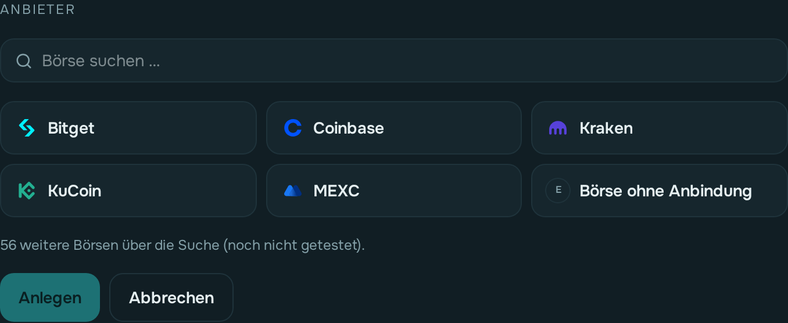
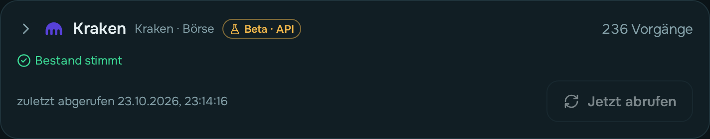
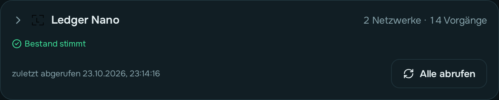

# Quellen einrichten und einlesen

Auf der Seite **Quellen** richtest du alles ein, woraus owncryptofolio seine Daten holt:
deine Börsen und deine Wallets. Am Handy findest du sie unter **Mehr → Quellen**.

Die Seite hat zwei Bereiche:

- **Börsen**: je Börsenkonto eine Karte, z. B. Bitget.
- **Wallets**: je Gerät oder App eine Karte, z. B. „Tangem Cold Wallet“. Darunter stehen
  die **Netzwerke** mit ihren Adressen, etwa Ethereum, Bitcoin, Solana, Tron oder XRP. So siehst du
  später auf einen Blick, was auf welchem Gerät liegt.

## Alle Quellen auf einen Blick

**getestet** heißt: an einem echten Konto geprüft, die Summe der Vorgänge stimmt mit dem
Kontostand. **Beta** heißt: nach der Dokumentation gebaut und an öffentlichen Adressen bzw.
Beispielen geprüft, aber noch nicht an einem eigenen Konto — rufe ab und schau in den
[Bestandsabgleich](#bestandsabgleich). Jede Börse lässt sich außerdem über eine
[eigene Datei](#eigene-datei-csvexcel--für-jede-börse) einlesen und von Hand ergänzen.

<!-- generated from the plugin registry; tests/test_wiki_sources.py checks it stays complete -->
| Börse | Abruf | Status |
|---|---|---|
| Bitget | API + Datei | getestet |
| Coinbase | API + Datei | getestet |
| Kraken | API (ccxt) + eigene Datei | getestet |
| KuCoin | API (ccxt) + eigene Datei | getestet |
| MEXC | API + Datei | getestet |
| Börse ohne Anbindung | von Hand | getestet |

| Netzwerk | Schlüssel | Status |
|---|---|---|
| Algorand | — | Beta |
| Arbitrum One | Etherscan (kostenlos), nötig | Beta |
| Avalanche C-Chain | — | getestet |
| Bitcoin | — | Beta |
| Bitcoin Cash | — | Beta |
| Blast | Etherscan (kostenlos), nötig | Beta |
| BNB Smart Chain | NodeReal (kostenlos), nötig | getestet |
| Cardano | — | getestet |
| Celestia | — | Beta |
| Celo | — | Beta |
| Cosmos Hub | — | Beta |
| Cronos EVM | Cronos Explorer (kostenlos), nötig | getestet |
| Dogecoin | — | Beta |
| Ethereum | — | getestet |
| Hedera | — | getestet |
| Kaspa | — | getestet |
| Linea | Etherscan (kostenlos), nötig | Beta |
| Litecoin | — | getestet |
| Mantle | Etherscan (kostenlos), nötig | Beta |
| NEAR | — | Beta |
| Optimism | — | Beta |
| Osmosis | — | Beta |
| Polkadot | — | getestet |
| Polygon | Etherscan (kostenlos), nötig | getestet |
| Ronin | — | getestet |
| Solana | — | getestet |
| Sonic | Etherscan (kostenlos), nötig | getestet |
| Stellar | — | Beta |
| Sui | — | getestet |
| Tezos | — | Beta |
| TON | toncenter, optional | Beta |
| Tron | TronGrid, optional | Beta |
| VeChain | — | getestet |
| XRP Ledger | — | Beta |
| zkSync Era | — | Beta |
| Netzwerk ohne Anbindung | — | getestet |

**Weitere 56 Börsen über ccxt** (API-Abruf, alle Beta):

| | | | |
|---|---|---|---|
| Alpaca | Backpack | Bequant | BigONE |
| Binance | Binance US | BingX | BIT.TEAM |
| Bitbns | Bitfinex | bitFlyer | BitoPro |
| Bitrue | Bitso | Bitstamp | BitTrade |
| Bitvavo | Blockchain.com | BloFin | BTC Markets |
| BTSE | Bullish | Bybit | Bybit EU |
| Bybit Indonesia | BYDFi | Coinbase Exchange | Coincheck |
| CoinEx | CoinMate | Coins.ph | Crypto.com |
| DeepCoin | DigiFinex | FMFW.io | Foxbit |
| Gate | Gate EU | Gemini | HashKey Global |
| HitBTC | HollaEx | HTX | Latoken |
| LBank | MyOKX (EEA) | NDAX | OKX |
| OKX (US) | Phemex | Poloniex | Tokocrypto |
| Toobit | WhiteBit | WOO X | XT |

Ein Schlüssel „nötig“ wird unter [Einstellungen → Blockchain-Dienste](einstellungen.md#blockchain-dienste)
eingetragen; „optional“ läuft ohne, nur langsamer.

## Eine Börse anlegen

  

1. **Börse hinzufügen** tippen, den Anbieter wählen, z. B. *Bitget*.
2. Eine Bezeichnung eingeben, z. B. „Bitget Hauptkonto“, dann **Anlegen**.

### Weitere Börsen (Beta)

Die meisten haben ein Logo aus einem freien Symbol-Set; fehlt es dort, holt owncryptofolio beim
ersten Anzeigen das Symbol von der Webseite der Börse und speichert es. Wo keins zu finden war,
steht der Anfangsbuchstabe — ein eigenes Logo kannst du auf der Karte hochladen.

Ohne Suchbegriff siehst du nur die **getesteten** Börsen (Bitget, Coinbase, Kraken, KuCoin,
MEXC) und **Börse ohne Anbindung**. Über die **Suche** findest du 56 weitere, z. B.
Binance, Bybit, OKX, Bitvavo oder Gate. Sie laufen über eine gemeinsame Schnittstelle und
tragen den Badge **Beta**: noch nicht mit einem echten Konto geprüft.

Beim Hinzufügen und später auf der Karte (unter **Abruf und Import**) steht, was schiefgehen
kann, etwa:

- Gebühren falsch oder doppelt abgezogen,
- nur ein begrenzter Zeitraum abrufbar,
- Trades von Coins, die du an der Börse gekauft **und** dort wieder ganz verkauft hast,
  fehlen (manche Börsen geben Trades nur je Handelspaar heraus),
- Futures, Margin, Earn/Staking, Umbuchungen und Euro-Einzahlungen werden nicht gelesen.

**Prüfe nach dem ersten Abruf den [Bestandsabgleich](#bestandsabgleich).** Weicht er ab,
ergänze per Datei-Import oder von Hand. Je nach Börse fragt das Formular nach API-Key,
Secret und zusätzlich Passphrase oder UID.

Bei Kraken und KuCoin ist der **Datei-Import getestet**, die API ist Beta; der Badge zeigt
dann „Beta · API“.

## Eine Wallet anlegen

1. **Wallet hinzufügen** tippen und einen Namen eingeben, z. B. „Tangem Cold Wallet“.
2. In der neuen Karte **Netzwerk hinzufügen**, das Netzwerk wählen und die **Adresse**
   einfügen. Passt sie nicht zum Netzwerk, steht sofort *„Diese Adresse passt nicht zu …“*
   darunter.
3. Für jedes weitere Netzwerk wiederholen. **Tipp:** Ethereum, Polygon, BNB, Avalanche,
   Cronos und Sonic nutzen auf Tangem und den meisten Wallets **dieselbe Adresse**. Steht
   in der Wallet schon eine davon, schlägt owncryptofolio sie vor.
4. **Alle abrufen** holt alle Netzwerke der Wallet auf einmal. Einzeln geht es über das
   Pfeil-Symbol neben dem Netzwerk.

Eine Wallet lässt sich umbenennen. Löschen geht erst, wenn keine Netzwerke mehr darin
stehen, und ein Netzwerk erst, wenn seine Importe zurückgenommen sind.

**Netzwerk ohne Anbindung:** Gibt es ein Netzwerk nicht in der Liste oder lässt es sich nicht
abrufen, wähle unter **Netzwerk hinzufügen** die Kachel **Netzwerk ohne
Anbindung**. Den Namen gibst du frei ein, die Adresse ist nur eine Notiz. Es wird nie
abgerufen; die Vorgänge trägst du auf der Seite [Transaktionen](transaktionen.md) ein.

> **Ronin**: Die Adresse aus der Ronin-Wallet (`ronin:…`) kannst du so einfügen, wie sie
> dort steht. Ronins Explorer lässt nur wenige Abfragen in kurzer Zeit zu; ein Abruf wartet
> dann ein paar Minuten und macht von selbst weiter.

## Börse: API-Schlüssel eintragen

**Die API ist der bevorzugte Weg.** Sie holt deine Historie direkt von der Börse.

1. Lege bei der Börse einen **API-Schlüssel nur mit Leserechten** an: ohne Handel und
   ohne Auszahlung. Bei Bitget brauchst du dafür API-Key, Secret und Passphrase.
2. Trage die Werte in der Karte unter **Abruf und Import → API-Zugang** ein und tippe **Schlüssel
   speichern**.
3. owncryptofolio prüft die Verbindung sofort. Darunter steht *„Verbindung funktioniert“*
   oder die Antwort der Börse, warum nicht.

Die Schlüssel werden **verschlüsselt** gespeichert und nie wieder angezeigt. Du siehst
nur, dass sie hinterlegt sind. Ändern, erneut prüfen oder entfernen geht jederzeit.

## So ist eine Karte aufgebaut

  
  

Börsen und Wallets sind als Karten eingeklappt: Du siehst Name, Anzahl der Vorgänge, den
Bestandsabgleich, wann zuletzt abgerufen wurde, und den Knopf zum Abrufen. Ein Tipp auf den
Namen klappt die Karte auf. Darin sind die Bereiche noch einmal einklappbar; die App merkt
sich, was du offen hast.

- **Börse**: **Bestandsabgleich** (offen) und **Abruf und Import** (zu). Darin der Hinweis,
  ab wann die API reicht, **täglich abrufen**, sowie einzeln **API-Zugang**, **Datei-Import**
  und **Importe**. Neben **API-Zugang** steht grün *Verbindung funktioniert* oder gelb
  *Verbindung fehlgeschlagen*; ein Fehler steht auch an **Abruf und Import**, damit du ihn im
  zugeklappten Zustand siehst.
- **Wallet**: **Bestandsabgleich** mit je einer Zeile pro Netzwerk (aufklappbar) und darunter
  **n Netzwerke** mit Adresse, Abruf-Knopf und **täglich abrufen**.

## Abrufen

Scheitert ein **automatischer** Abruf an einer Zeitüberschreitung oder einem
Verbindungsfehler (etwa weil der Dienst gerade langsam ist), startet ihn die App nach
15 Minuten selbst noch einmal, höchstens dreimal. Ein abgelehnter Schlüssel wird nicht
wiederholt, der braucht dich.

Ist ein Abruf fehlgeschlagen, steht oben auf der Seite ein gelber Hinweis. Daneben holt
**Erneut abrufen** genau diese Quelle noch einmal; klappt es, verschwindet der Hinweis.

**Alle abrufen** oben auf der Seite holt alle Börsen mit API-Schlüssel und alle
Wallet-Netzwerke auf einmal. Jeden Morgen geschieht das von selbst (Einstellungen →
Automatischer Abruf).

**Jetzt abrufen** holt die Daten im Hintergrund. Du kannst die Seite währenddessen
verlassen. Neben dem Knopf siehst du den Fortschritt und am Ende, wie viele Vorgänge
**neu** waren und wie viele **bekannt**.

Kann ein Abruf nicht alles lesen (etwa weil ein Knoten mitten im Blättern abbricht oder
Transaktionen nicht liefert), **scheitert er mit einer Meldung** und speichert nichts, statt
stillschweigend Lücken zu lassen. Lehnt ein Blockchain-Dienst deinen Schlüssel ab, steht genau
das in der Meldung; einen gültigen trägst du unter **Einstellungen → Blockchain-Dienste** ein.

- Der **erste** Abruf holt alles, was die Quelle hergibt. Bei Bitget dauert das etwa
  8 Minuten, weil Bitget nur langsame Abfragen erlaubt.
- Jeder weitere Abruf holt nur, was seitdem dazugekommen ist, und liest ein Stück zurück:
  Börsen zwei Wochen (damit tagelang ausstehende Ein- und Auszahlungen nicht fehlen), Wallets
  zwei Tage. Bereits bekannte Vorgänge werden erkannt und nicht doppelt gespeichert.
- Bei einer Wallet braucht es meist nur die Adresse. Einige Netzwerke brauchen einen
  **kostenlosen Schlüssel** eines Blockchain-Dienstes, einzutragen unter
  **Einstellungen → Blockchain-Dienste**:

  | Netzwerk | Dienst |
  |---|---|
  | Ethereum, Avalanche, Bitcoin, Litecoin, Solana, Cardano, Kaspa, Polkadot, VeChain, Hedera, Sui, Stellar | keiner |
  | Polygon, Sonic, Arbitrum One, Blast, Linea, Mantle | Etherscan |
  | Cronos EVM | Cronos Explorer (nur CRO, keine Token) |
  | BNB Smart Chain | NodeReal MegaNode |

  **Polkadot** liest automatisch beide Teile der Kette (Relay Chain und Asset Hub, Umzug
  am 04.11.2025). Du legst Polkadot nur einmal an. Ein **Stellar**-Konto, auf dem noch nie
  etwas angekommen ist, gibt es auf der Kette noch nicht: Der Abruf meldet dann einfach
  0 Vorgänge.

## Datei einlesen (nur wenn die API nicht reicht)

Manche Zeiträume erreicht die API nicht. Dafür gibt es den **Datei-Import**, z. B. die
ZIP-Ausfuhr „Order-Verlauf exportieren“ von Bitget.

1. In der Karte **Abruf und Import → Datei-Import → Datei(en) wählen**. owncryptofolio zeigt
   zuerst eine **Vorschau** und speichert dabei noch nichts:
   - wie viele Vorgänge **gelesen**, **schon per Datei eingelesen**, **durch API abgedeckt**
     oder **abgewiesen** sind und wie viele davon neu dazukommen und zählen;
   - den Zeitraum der Datei;
   - die Arten, etwa Handel, Senden oder Futures-Funding.
2. Passt alles, **Übernehmen**. Sonst **Abbrechen**.

Die Originaldatei wird bei jeder Übernahme unverändert aufbewahrt.

> **Wenn die API einen Zeitraum schon abdeckt**, steht das in der Karte, getrennt für
> Spot und Futures (bei Bitget reicht die API für Futures weniger weit zurück). Datei-Zeilen aus diesem Zeitraum werden zwar gespeichert, **zählen aber
> nicht**. In der Transaktionsliste erscheinen sie blass mit dem Hinweis *„durch API
> abgedeckt“*. So zählt kein Vorgang doppelt, egal ob du zuerst die Datei oder zuerst
> die API einliest.

## Eigene Datei (CSV/Excel) — für jede Börse

Hat deine Börse keine Anbindung oder fehlt etwas, lade ihren Export selbst hoch: auf der
Karte der Börse unter **Abruf und Import → Eigene Datei (CSV/Excel)** (Beta). Das geht bei
jeder Börse, auch bei **Börse ohne Anbindung**.

1. **Datei wählen** (CSV oder Excel). Unter **Originaldatei ansehen** (aufklappbar) siehst du
   die ersten Zeilen so, wie sie in der Datei stehen — die Überschrift markiert, darüber, welchem
   Feld jede Spalte zugeordnet ist. Trennzeichen, Zahlenformat, Überschriftenzeile und
   Datumsformat werden erkannt; du kannst sie ändern. Die **Zeitzone der Datei** ist deine
   eingestellte; viele Börsen schreiben UTC — dann umstellen.
2. **Aufbau** wählen:
   - *Eine Zeile je Bewegung*: Datum, Art, Coin, Menge. Ein Kauf steht entweder in **einer**
     Zeile mit Gegenwert (Coinbase: Menge BTC, Gegenwert in EUR) oder in **zwei** Zeilen mit
     derselben ID (Kraken: Plus-Zeile Zugang, Minus-Zeile Abgang).
   - *Eine Zeile je Trade*: Datum, Handelspaar, Kauf/Verkauf, Menge, Preis oder Summe.
3. **Spalten zuordnen**: Vorschläge sind schon eingetragen, Pflichtfelder rot, solange sie fehlen.
4. **Werte zuordnen**: jedes Wort der Art-Spalte („Buy“, „Staking Income“ …) bekommt eine
   Art — Kauf, Verkauf, Tausch (aus der Notiz, z. B. „Converted 0.1 ETH to 0.003 BTC“),
   Trade-Hälfte, Einzahlung, Auszahlung, Ertrag, Umbuchung zwischen eigenen Konten, Gebühr
   oder *Ignorieren*. Die meisten Wörter sind schon richtig vorgeschlagen; Hälften eines
   Trades erkennt owncryptofolio an der gemeinsamen ID mit umgekehrtem Vorzeichen. Hat die Datei keine Art-Spalte (z. B. eine reine Einzahlungsliste), wählst
   du, was alle Zeilen sind.
5. **Vorschau**: jede Zeile so, wie sie gebucht würde; Zeilen, die nicht lesbar sind, stehen
   mit Zeilennummer und Grund da. Erst dann **Importieren**.

Die Zuordnung merkt sich owncryptofolio für die nächste Datei dieser Quelle. Die Originaldatei
und die Zuordnung werden zusammen aufbewahrt; ein Import lässt sich wie jeder andere
zurücknehmen. Doppelte Zeilen werden erkannt.

## Von Hand erfassen

Für Börsen, die nichts mehr hergeben (z. B. Gate.io oder SafeTrade, die nur 180 Tage
zurückreichen): **Börse hinzufügen** → **Börse ohne Anbindung**, Namen eingeben. Die Vorgänge
erfasst du dann auf der Seite **Transaktionen**, einzeln oder per Vorlage; dort bearbeitest,
korrigierst und markierst du auch alles andere. Siehe [Transaktionen](transaktionen.md).

Eine Börse ohne Anbindung lässt sich löschen, sobald alle ihre Vorgänge gelöscht sind.

## Neue Netzwerke (Beta)

Seit v1.7.2 gibt es **XRP Ledger, Tezos, Algorand, Tron, TON, Dogecoin und Bitcoin Cash**, seit v1.7.3 auch **NEAR, Cosmos Hub, Osmosis und Celestia**. Sie
sind an öffentlichen Adressen geprüft (Summe der Vorgänge = Kontostand), aber noch nicht an
einer eigenen Wallet — daher „Beta“. Ein paar Besonderheiten:

- **Tron** und **TON** laufen ohne Schlüssel, nur langsamer (kurze Pausen zwischen den
  Abfragen). Wer viele Vorgänge hat, legt unter Einstellungen → Blockchain-Dienste einen kostenlosen
  Schlüssel von TronGrid bzw. toncenter an.
- **Gestaktes TRX** (eingefroren oder delegiert) zählt weiter zu deinem Bestand.
- **Staking-Erträge** kommen als Einkommen: Baker-Auszahlungen bei Tezos, Teilnahme-Belohnungen
  bei Algorand, Stimm-Belohnungen bei Tron.
- **Bitcoin Cash** braucht die Adresse im CashAddr-Format (`bitcoincash:q…` oder ohne Präfix).
- Nicht gelesen werden u. a. NFTs, DEX-Handel auf dem XRP Ledger und eigenes Tezos-Staking —
  das steht bei jedem Netzwerk unter „Nicht gelesen“.

### NEAR und Cosmos

- **NEAR** (Beta): NEAR und Token (NEP-141). Der Bestand stimmt auf das yoctoNEAR mit dem
  Kontostand überein. **Staking** erscheint als „gesendet an den Pool“ und „empfangen vom Pool“;
  die Erträge kommen mit der Auszahlung zurück und stehen nicht gesondert als Einkommen da.
  Token, die nichts ins Protokoll schreiben, lassen sich nicht lesen — dann zeigt der
  Bestandsabgleich die Lücke. Bei sehr großen Konten (Tausende Vorgänge) dauert der
  erste Abruf lange, weil für jeden Token die Eigenschaften abgefragt werden; danach geht es nur
  noch um das Neue.
- **Cosmos Hub, Osmosis und Celestia** (Beta): Überweisungen, IBC-Coins und Staking-Erträge als
  Einkommen. Staking selbst (delegieren, entstaken) bewegt nichts: gestakte Coins bleiben in
  deinem Bestand. **Wichtige Grenze:** Die kostenlosen öffentlichen Knoten behalten nur wenige
  Monate Geschichte. Ältere Vorgänge fehlen dann; der Bestandsabgleich zeigt die Lücke, und den
  älteren Teil erfasst du von Hand oder per Datei. Bricht ein Knoten dagegen mitten im Lesen ab,
  scheitert der Abruf mit einer Meldung, statt Vorgänge auszulassen.

## Wenn die Quelle eine Buchung ändert

Manchmal korrigiert eine Börse eine Buchung nachträglich, etwa einen Betrag. Beim nächsten
Abruf kommt dieselbe Buchung (gleiche Transaktions-ID und Zeit) mit anderen Werten. owncryptofolio
fügt sie dann **nicht** ein zweites Mal ein, sondern zeigt oben auf dieser Seite die Karte
**„n Zeilen von der Quelle geändert“** — mit den bisherigen und den neuen Werten:

- **Neue Werte übernehmen**: Die neue Buchung ersetzt die alte. Die alte bleibt gespeichert und
  steht im Verlauf der Zeile.
- **Bisherige behalten**: Es bleibt, wie es war. Dieselbe Änderung wird dir nicht wieder gezeigt.

In der Statistik zählt die Kontogesundheit solche Fälle unter „Von der Quelle geändert“.
Buchungen ohne Transaktions-ID (z. B. Bitget- und MEXC-Dateien) lassen sich so nicht
wiedererkennen.

## Einen Import zurücknehmen

Unter **Abruf und Import → Importe** steht jeder Abruf und jede Datei mit Datum, Anzahl und Zeitraum. Der
jeweils **letzte** Import einer Quelle hat den Knopf **Zurücknehmen**. Nach einer
Rückfrage werden genau die Vorgänge dieses Imports entfernt, nichts sonst.

Eine Quelle lässt sich erst löschen, wenn alle ihre Importe zurückgenommen sind.

## Was du danach siehst

Unter **Transaktionen** stehen alle eingelesenen Vorgänge. Ein Transfer von der Börse auf
deine Wallet steht dort als **eine** Zeile, siehe
[Transaktionen zusammenführen](../konzepte/transaktionen-zusammenfuehren.md).

## Bestandsabgleich

Bei jedem Abruf fragt owncryptofolio auch den **aktuellen Kontostand** ab und vergleicht ihn
mit dem Bestand, der sich aus deinen Vorgängen ergibt. Auf jeder Karte steht das Ergebnis:

- **Bestand stimmt**: alles passt (Toleranz 0,1 %; bei Euro, Dollar und Dollar-Coins wie
  USDT bis 5 Cent, weil Börsen nur Cent anzeigen).
- **n Abweichungen**: bei n Coins passt es nicht. Aufgeklappt zeigt eine Tabelle Coin,
  errechnet, Kontostand und Differenz.
- **nicht geprüft**: noch kein Kontostand bekannt, oder dieser Coin konnte nicht abgefragt
  werden (bei Wallets werden nur Token gefragt, die in deinen Vorgängen vorkommen).

Geld, das die App bei einem Kartenkauf als Einzahlung annimmt, zählt der Abgleich mit.
Bei MEXC und Bitget wird auch das **Futures-Konto** abgefragt.

Eine Abweichung heißt fast immer: **Vorgänge fehlen**, zum Beispiel ein älterer Zeitraum
ohne Datei, eine Einzahlung in Euro oder ein Ertrag, den die Quelle nicht als Vorgang meldet
(VTHO entsteht bei VeChain einfach durch das Halten von VET). Ein negativer errechneter
Bestand zeigt: Hier wurde mehr verkauft oder verschickt, als je angekommen ist. Wo genau,
zeigt [Bestände → Lücken](portfolio.md#lücken).

Bei **Börsen ohne Anbindung** (Gate.io, SafeTrade) trägst du den Kontostand je Coin unter
dem Abgleich selbst ein.

## Verwandte Seiten

- [Integrationen](../konzepte/integrationen.md): was eine Quelle kann und was nicht
- [Sicherung](sicherung.md): bevor du viele Daten einliest
