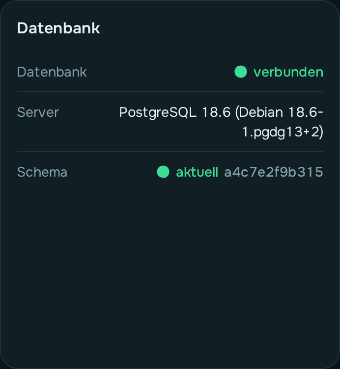
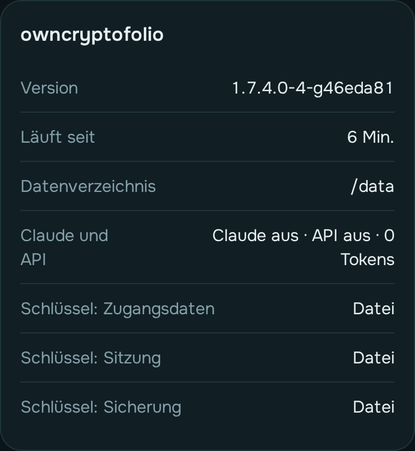
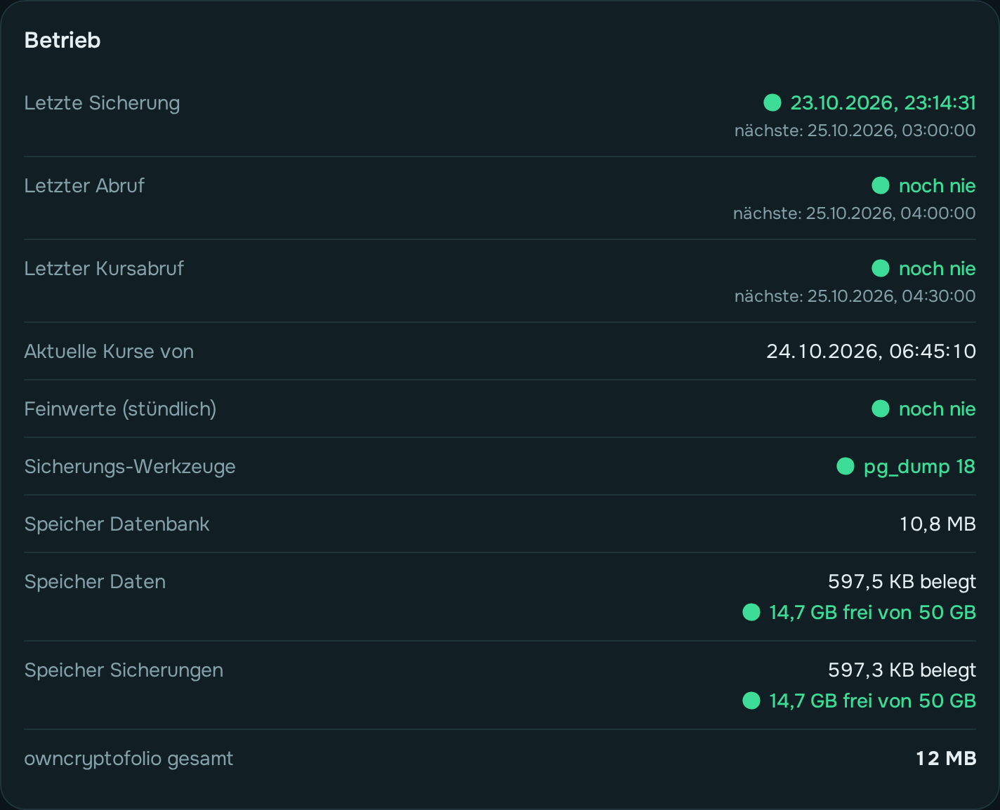

# Systemzustand

Die Seite **Systemzustand** (am Handy unter **Mehr**) beantwortet eine Frage: **Läuft
alles?** Ist etwas nicht in Ordnung, ist die Zeile gelb.

## Datenbank

  

- **Datenbank**: *verbunden*, wenn owncryptofolio die Datenbank erreicht.
- **Server**: die Version von PostgreSQL.
- **Schema**: *aktuell*, wenn die Datenbank auf dem Stand der Programmversion ist. Nach einem
  Update bringt der Start sie selbst auf den neuen Stand.

## owncryptofolio

  

- **Version** und **Läuft seit**.
- **Claude und API**: ob Claude und die API an oder aus sind, wie viele Tokens es gibt, und der
  letzte Aufruf — siehe [Claude anbinden](claude-anbinden.md) und [API](api.md).
- **Datenverzeichnis**: wo Schlüssel, eingelesene Originaldateien und Protokolle liegen.
- **Schlüssel**: ob die drei Schlüssel (Zugangsdaten, Sitzung, Sicherung) aus einer Datei
  oder aus der Umgebung kommen.

## Betrieb

  

Was von selbst laufen soll, und wann es zuletzt lief:

| Zeile | Was sie sagt | Wenn sie gelb ist |
|---|---|---|
| **Letzte Sicherung** | Zeitpunkt, darunter die nächste geplante | Die Sicherung oder ihre Probe ist fehlgeschlagen. Grund steht darunter, siehe [Sicherung](sicherung.md). |
| **Letzter Abruf** | der letzte Abruf aller Quellen, die nächste Runde | Bei *n fehlgeschlagen* ging mindestens eine Quelle nicht. Welche, steht auf der Seite Quellen und im Dashboard unter Hinweise. Oft klappt es beim nächsten Mal von selbst. |
| **Letzter Kursabruf** | der tägliche Abruf der Tageskurse | Der Kursabruf ist fehlgeschlagen. **Kurse abrufen** auf der Seite Kurse versucht es erneut. |
| **Aktuelle Kurse von** | wann zuletzt aktuelle Kurse geholt wurden | – |
| **Sicherungs-Werkzeuge** | ob die PostgreSQL-Werkzeuge da sind und zur Datenbank passen | Es kann keine Sicherung entstehen. Im Container: neu bauen (siehe [Installation](installation-docker.md)). |
| **Speicher Datenbank** | wie groß die Datenbank ist | – |
| **Speicher Daten / Sicherungen** | was owncryptofolio dort belegt, darunter der freie Platz | Weniger als 5 % frei. Platz schaffen, sonst bleiben Sicherungen aus. |
| **owncryptofolio gesamt** | Datenbank, Daten und Sicherungen zusammen | – |

Die Uhrzeiten stellst du unter **Einstellungen** ein: Abruf (Standard 04:00), Kurse (04:30),
Sicherung (03:00).

**Feinwerte (stündlich)**: holt feine Kurse je Coin nach und rechnet daraus die Werte für
die kurzen Zeiträume im Dashboard neu — auch gleich nach einem Start, damit Lücken aus der
Zeit, in der die App nicht lief, sich füllen.

## Hintergrundaufträge

Die letzten Abrufe, Kursabrufe, Feinkurse und Sicherungen mit Quelle, Zeitpunkt und Ergebnis.
Bei einem Fehler steht die Meldung darunter.

## Protokoll

Die Karte ist zunächst **eingeklappt**; ein Klick auf *Protokoll* öffnet sie. Dann siehst du,
was owncryptofolio gerade tut, **live**: alle zwei Sekunden kommen die neuen Zeilen dazu.
Scrollst du nach oben, bleibt die Ansicht stehen; ganz unten folgt sie wieder.

- **Loglevel**: wie viel geschrieben wird. *Info* ist normal. *Debug* schreibt sehr viel —
  zum Suchen eines Fehlers einschalten, danach wieder auf *Info* stellen. Die Einstellung gilt
  sofort und bleibt nach einem Neustart.
- **Anzeigen**: blendet nur in der Ansicht aus, z. B. *ab Warnung*.
- **Herkunft**: *Backend* ist der Server, *Frontend* sind Fehler und Warnungen aus deinem
  Browser (etwa wenn eine Seite nicht lädt).
- **Suchen**, **Live** (anhalten), **Ansicht leeren** und **Als Datei** (speichert die
  angezeigten Zeilen als Text, z. B. zum Weitergeben).

Gezeigt werden die letzten 2.000 Zeilen seit dem letzten Start. **Adressen werden gekürzt,
Schlüssel und Passwörter ausgeblendet** — du kannst eine gespeicherte Datei weitergeben.
Den vollständigen Verlauf hat der Container (`docker logs`).

## Lizenzen

Wessen freie Werke owncryptofolio nutzt (Symbole, Schriften, Bibliotheken) und unter welcher
Lizenz, dazu der Hinweis zu den Marken: [Lizenzen und Marken](../konzepte/lizenzen.md).
